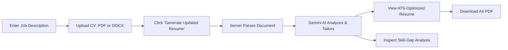

# 🚀 ResumePilot AI

> **An AI-powered ATS resume updater and skill-gap analyzer that tailors an existing CV to match any job description.**  
> Built with **Next.js (App Router)**, **TypeScript**, **Tailwind CSS**, and **Google Gemini AI**.

---

## 📌 Project Overview

**ResumePilot AI** is an intelligent web application designed to help job seekers bypass Applicant Tracking Systems (ATS) and secure more interview callbacks. By comparing an applicant's existing CV against a target Job Description, ResumePilot AI:
1. **Extracts text** directly from uploaded **PDF (.pdf)** and Word **DOCX (.docx)** documents.
2. **Aligns and tailors** bullet points using strong action verbs, quantifiable metrics, and target job keywords.
3. **Preserves 100% of the candidate's real truth** — never hallucinates or invents fake employers, degrees, or certifications.
4. **Performs a segregated Skill-Gap Analysis**, distinguishing matching skills from missing job requirements so candidates know exactly what to prepare for.
5. **Renders a single-column, ATS-compliant preview** with instant **downloadable standard A4 PDF** generation.

---

## ✨ Key Features

- **Clean 2-Input UI:** Minimalist, user-friendly interface with exactly two fields: Target Job Description and CV File Upload.
- **Real Document Extraction:** Parses `.pdf` using server-side binary stream parsing and `.docx` using `mammoth`.
- **Google Gemini AI Engine:** Leverages Gemini 1.5 / 2.0 Flash with temperature controls for high factual fidelity.
- **Truth-Preserving Guarantee:** Existing qualifications, degrees, GPA, and employment history are never altered or fabricated.
- **Skill-Gap Analysis:** Computes a compatibility match score (0–100%) and categorizes matching vs. missing competencies.
- **Downloadable A4 PDF:** High-resolution client-side PDF export (`jsPDF` + `html2canvas`) and native print-to-PDF styles.
- **Interactive Editing:** Edit resume details directly in the preview before saving or exporting.
- **One-Click Sample Mode:** Evaluators can load a sample tech job description and CV to test the entire pipeline in seconds.
- **Zero API Key Leakage:** The Gemini API key is executed strictly in server-side Next.js route handlers (`/api/tailor`) and kept safe in `.env.local`.

---

## 🛠️ Tech Stack & Dependencies

| Layer | Technologies |
| :--- | :--- |
| **Frontend Framework** | [Next.js 14 (App Router)](https://nextjs.org/) |
| **Language** | [TypeScript](https://www.typescriptlang.org/) |
| **Styling** | [Tailwind CSS](https://tailwindcss.com/) & [Lucide Icons](https://lucide.dev/) |
| **AI Integration** | [@google/generative-ai](https://www.npmjs.com/package/@google/generative-ai) (Google Gemini API) |
| **Document Parsers** | [mammoth](https://www.npmjs.com/package/mammoth) (DOCX) & [pdf-parse](https://www.npmjs.com/package/pdf-parse) (PDF) |
| **PDF Generation** | [jspdf](https://www.npmjs.com/package/jspdf) & [html2canvas](https://www.npmjs.com/package/html2canvas) |

---

## 📋 Prerequisites

Before running the application, make sure you have:
- **Node.js**: Version `18.17.0` or higher (Node 20+ recommended)
- **npm** or **yarn** or **pnpm**
- A free **Google Gemini API Key** from [Google AI Studio](https://aistudio.google.com/app/apikey)

---

## ⚙️ Installation & Setup

### 1. Clone or Open the Repository
```bash
git clone https://github.com/your-username/resumepilot-ai.git
cd resumepilot-ai
```

### 2. Install Dependencies
```bash
npm install
```

### 3. Configure the Gemini API Key
Create a `.env.local` file in the root directory:
```bash
cp .env.example .env.local
```

Open `.env.local` and add your Google Gemini API key:
```env
# Google Gemini API Key (Never commit this file to version control)
GEMINI_API_KEY=AIzaSy...your_actual_key_here
```

> **Where to get a key?**
> 1. Visit [Google AI Studio](https://aistudio.google.com/app/apikey).
> 2. Sign in with your Google Account and click **"Create API Key"**.
> 3. Copy the key and paste it into `.env.local`.

---

## 💻 Running the Application

### Development Mode
Start the Next.js local development server:
```bash
npm run dev
```
Open your browser and navigate to:
```
http://localhost:3000
```

### Production Build
To create an optimized production build:
```bash
npm run build
npm run start
```

---

## 🧪 Running Automated Tests

Run the included verification suite to validate document parsers, sample schemas, security configs, and SDK hooks:
```bash
npm test
```
Sample test output:
```
==========================================
ResumePilot AI - Automated Verification
==========================================

--- Test Suite 1: Sample Data & Schemas ---
[PASS] Sample JD loaded successfully
[PASS] Sample Resume contains structured sections

--- Test Suite 2: Document Extraction Library Tests ---
[PASS] Mammoth DOCX parser is loaded and available
[PASS] pdf-parse library is loaded and available

--- Test Suite 3: Gemini SDK Integration ---
[PASS] GoogleGenerativeAI client initializes correctly

--- Test Suite 4: Security & Environment Check ---
[PASS] .gitignore prevents leaking .env.local to Git/Vercel
[PASS] .env.example template is present for users

==========================================
Results: 7 of 7 tests passed.
==========================================
```

---

## 🧭 User Flow Walkthrough



1. **Enter Job Description:** Paste the complete target job posting or click *"Load Sample JD"*.
2. **Upload Existing CV:** Drag and drop your `.pdf` or `.docx` resume or click *"Try Sample Resume"*.
3. **Generate:** Click the gradient *"Generate Updated Resume"* button.
4. **Analyze:** Review your ATS Match Score, highlighted matching skills, and identified missing skills.
5. **Download:** Click *"Download A4 PDF"* to export a cleanly formatted, single-column resume ready to submit.

---

## 🌐 Deployment to Vercel

The application is fully compatible with [Vercel](https://vercel.com/):

### Option A: Via Vercel Dashboard (Recommended)
1. Push your project to GitHub (see below).
2. Go to [vercel.com](https://vercel.com/) and click **"Add New Project"**.
3. Import your `resumepilot-ai` repository.
4. In the **Environment Variables** section:
   - Key: `GEMINI_API_KEY`
   - Value: `your_gemini_api_key`
5. Click **Deploy**. Vercel will build and deploy your site in ~1 minute.

### Option B: Via Vercel CLI
```bash
npm i -g vercel
vercel
# When prompted, add GEMINI_API_KEY as an environment secret
```

---

## 📦 Pushing to GitHub

1. Initialize Git in the project root:
```bash
git init
```

2. Verify that `.env.local` is ignored:
```bash
git status
```
*(Ensure `.env.local` is NOT listed under untracked files)*

3. Add and commit all files:
```bash
git add .
git commit -m "feat: complete ResumePilot AI application"
```

4. Create a repository on GitHub, then link and push:
```bash
git branch -M main
git remote add origin https://github.com/your-username/resumepilot-ai.git
git push -u origin main
```

---

## 🔒 Security & Privacy

- **No API Key Exposure:** The `GEMINI_API_KEY` is loaded exclusively inside the server-side Next.js route `/api/tailor`. Client code never has access to the secret key.
- **Protected Environment:** `.gitignore` excludes `.env*`, `.env.local`, and credentials.
- **In-Memory Document Processing:** Files uploaded by users are processed in memory and never stored permanently on disk.

---

## 🎓 College Project Evaluation Highlights

- **Adherence to Requirements:** Exactly two input fields, authentic PDF/DOCX file parsing, Google Gemini AI integration, truth preservation, and single-column ATS layout.
- **Full-Stack Implementation:** Complete frontend (Tailwind + React 18), backend API route handler, document parsing engine, and PDF generator.
- **Clean Code Architecture:** Modular structure with decoupled components (`Header`, `InputSection`, `ResumePreview`, `SkillGapAnalysis`, `DownloadPdfButton`, `LoadingOverlay`) and typed interfaces.

---

## 📄 License
This project is open-source under the [MIT License](LICENSE).
